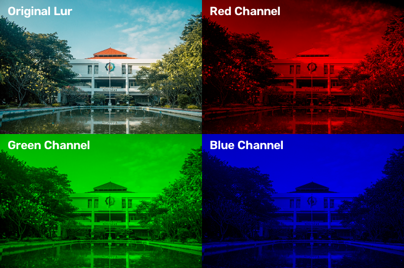

# Tugas 1

> Mata Kuliah : Pengolahan Citra dan Video  
> Nama : Yuke Brilliant Hestiavin  
> NRP : 5024241016  
> Dosen : Ir. Arta Kusuma Hernanda S.T.,M.T.

Tugas 1 adalah melakukan filter salah satu channel warna (BGR) pada foto dan video

## 1. Hasil Foto:

## 2. Hasil Video

https://github.com/user-attachments/assets/a19bdf1f-3bb3-4634-82fd-3723d630d0cc

