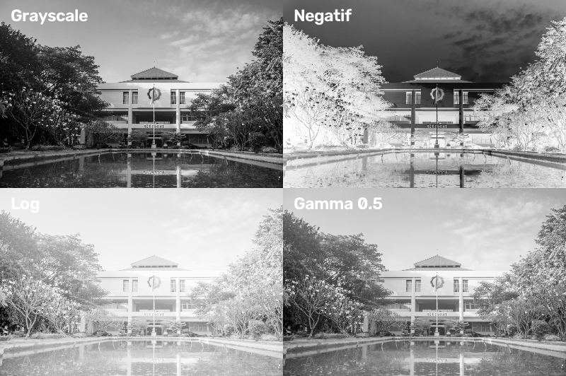
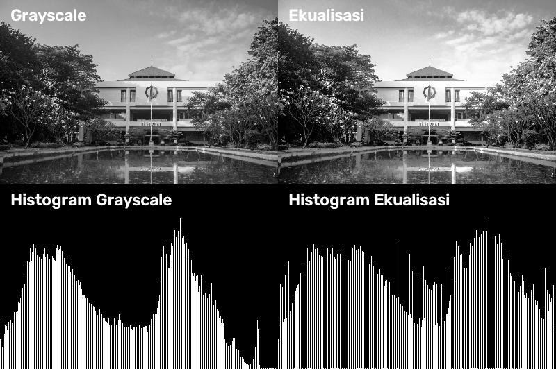

# Tugas 2

> Mata Kuliah : Pengolahan Citra dan Video  
> Nama : Yuke Brilliant Hestiavin  
> NRP : 5024241016  
> Dosen : Ir. Arta Kusuma Hernanda S.T.,M.T.

Tugas 2 adalah menerapkan transformasi intensitas dan ekualisasi histogram tanpa menggunakan fungsi bawaan package

## 1. Transformasi Intensitas

Transformasi yang dipakai: negatif, log, dan gamma (0.5)

## 2. Ekualisasi Histogram

