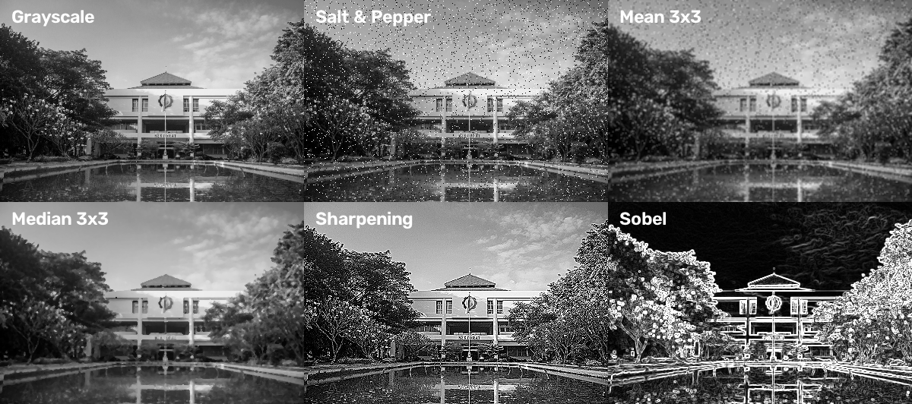

# Tugas 3

> Mata Kuliah : Pengolahan Citra dan Video  
> Nama : Yuke Brilliant Hestiavin  
> NRP : 5024241016  
> Dosen : Ir. Arta Kusuma Hernanda S.T.,M.T.

Tugas 3 adalah menerapkan filter spasial pada gambar

Filter yang dipakai: mean 3x3 dan median 3x3 (pada gambar yang dikasih noise salt & pepper), sharpening (laplacian), dan deteksi tepi sobel

## Hasil:

