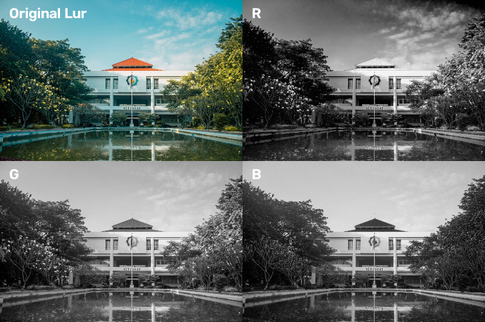
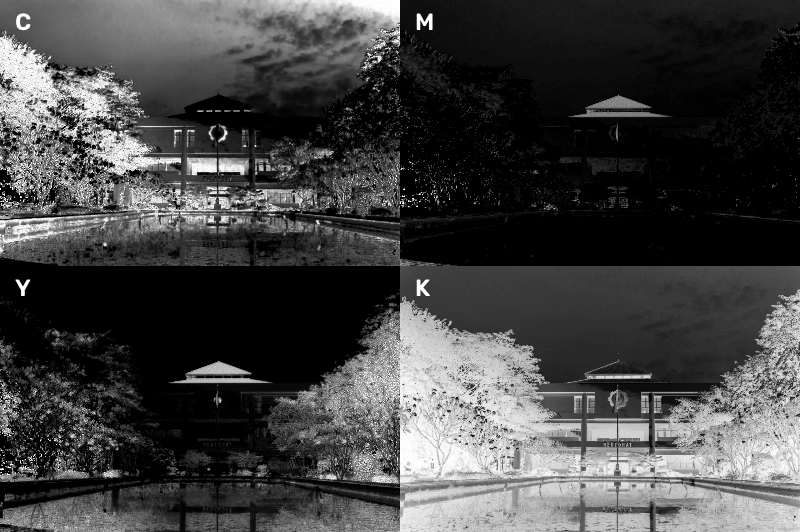
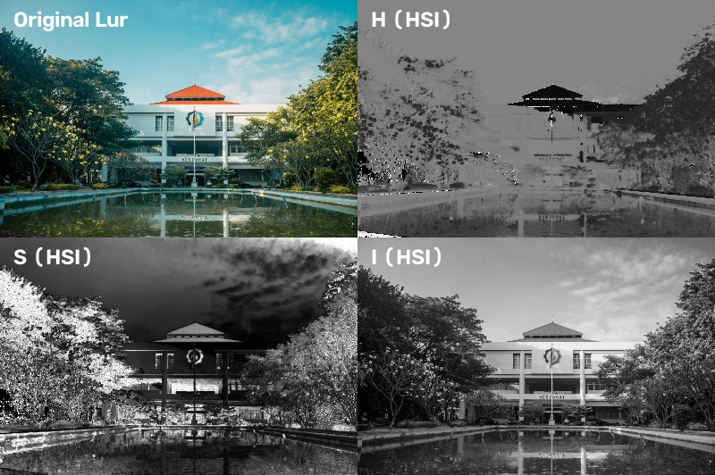
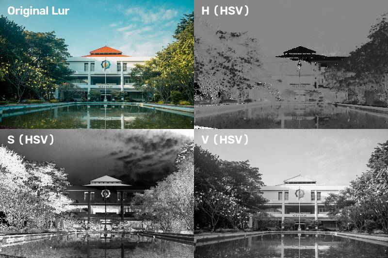

# Tugas 4

> Mata Kuliah : Pengolahan Citra dan Video  
> Nama : Yuke Brilliant Hestiavin  
> NRP : 5024241016  
> Dosen : Ir. Arta Kusuma Hernanda S.T.,M.T.

Tugas 4 adalah konversi model warna RGB ke CMYK, HSI, dan HSV. Tiap channel ditampilkan sebagai gambar grayscale (hue 0-360 derajat diskalakan ke 0-255)

## 1. RGB

## 2. CMYK

## 3. HSI

## 4. HSV

