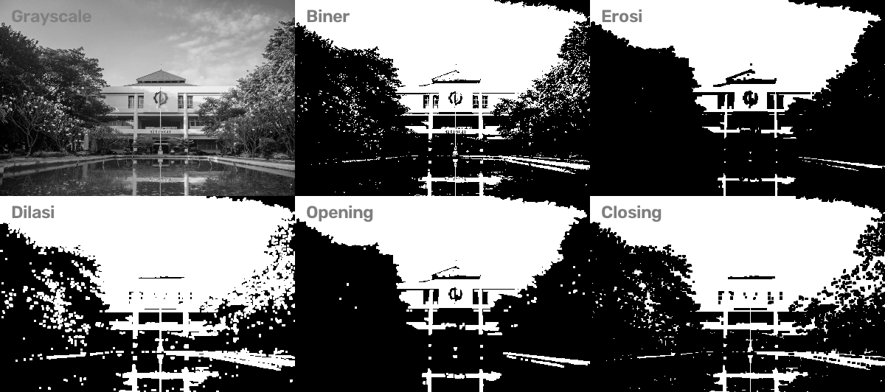

# Tugas 5

> Mata Kuliah : Pengolahan Citra dan Video  
> Nama : Yuke Brilliant Hestiavin  
> NRP : 5024241016  
> Dosen : Ir. Arta Kusuma Hernanda S.T.,M.T.

Tugas 5 adalah menerapkan operasi morphology (erosi, dilasi, opening, closing) pada gambar biner

Gambar diubah ke grayscale lalu di-threshold (127) jadi biner, kemudian diproses dengan structuring element kotak 3x3

## Hasil:

